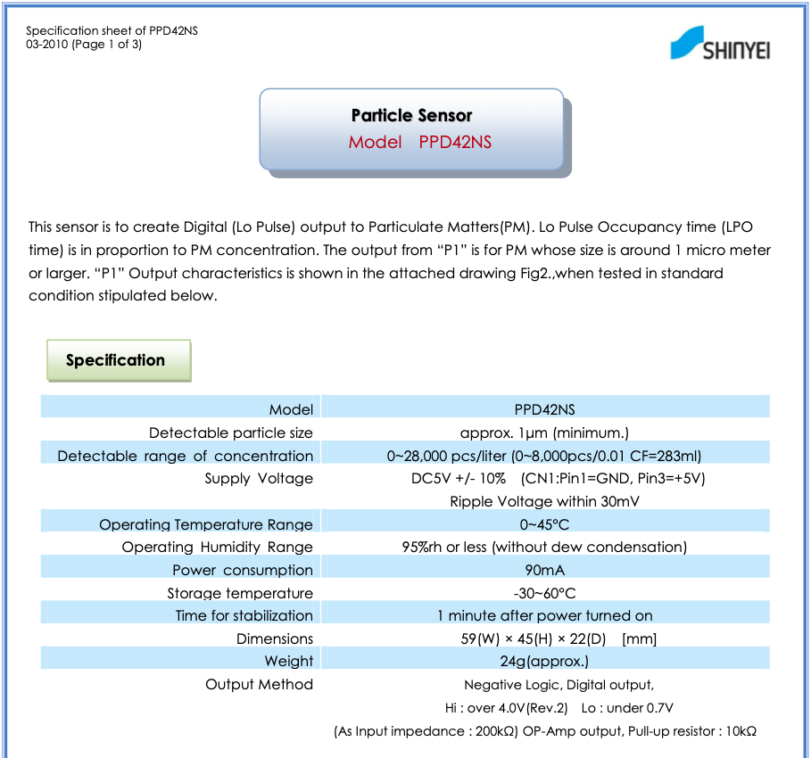

# AQI
All Things Air Quality

Starting with a Grove Dust sensor (data sheet in assets folder) to make an inside air quality sensor. The sensor uses light to determine amount of 'dust' particles in the air. Spec says >= 1um.

## Target Microcontroller
ESP32-S3 Feather will host a serve a web page that can be connected to locally. Server port will allow download of stored data.

* Sample rate of Dust Sensor every 10 minutes.
* Data stored locally as CSV 
* Time stamp validated data points
* One file per 24h period w/rollover at midnight

## Power Supply
5V AC Adapter to USB-C Cable

